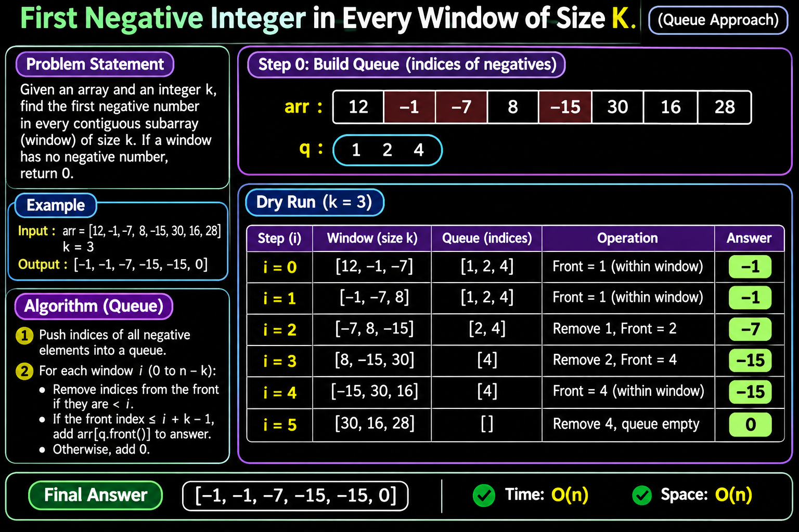

# Pattern 6 - Deque for Sliding-Window Candidates

**Pattern:** Fixed-size Sliding Window + Deque  
**Data structures:** `Deque<Integer>`, `ArrayDeque<Integer>`  
**Main techniques:** FIFO Deque of useful indices and Monotonic Deque

## Pattern Overview

A Deque (Double-Ended Queue) allows insertion and removal from both the front and rear.

For sliding-window problems, we use it to maintain only the elements or indices that can still contribute to the answer for the current window.

There are two techniques in this pattern:

**1. FIFO Deque of useful indices**

- Store only the indices that matter (for example, indices of negative numbers).
- Remove expired indices from the front.
- The front gives the earliest valid candidate.
- No monotonic ordering is maintained.

**2. Monotonic Deque**

- Maintain candidates in increasing or decreasing value order.
- Remove expired indices from the front.
- Remove dominated candidates from the rear.
- The front gives the current window's minimum or maximum candidate.

**Important:** First Negative Integer in Every Window uses a normal FIFO Deque of indices. It is **not** a Monotonic Deque.

## Revision Navigation

| No. | Problem | Main Pattern |
|---:|---|---|
| 1 | First Negative Integer in Every Window of Size K — GFG | FIFO Deque of negative indices |
| 2 | Sliding Window Maximum — LeetCode 239 | Decreasing Monotonic Deque |
| 3 | Longest Continuous Subarray With Absolute Diff Less Than or Equal to Limit — LeetCode 1438 | Two Monotonic Deques |

This revision file gives the complete walkthrough for Problem 1, which has been covered so far. Problems 2 and 3 are listed for the next stage; their full explanations and implementations are not added here yet.

---

## 1. First Negative Integer in Every Window of Size K

**Platform:** GeeksforGeeks  
**Difficulty:** Medium  
**Technique:** Fixed-Size Sliding Window + FIFO Deque of Indices  
**Practice:** [First Negative Integer in Every Window of Size K](https://www.geeksforgeeks.org/problems/first-negative-integer-in-every-window-of-size-k3345/1)

### Problem Understanding

Given an integer array `arr[]` and a window size `k`, find the **first negative number from left to right** in every contiguous window of size `k`.

If a window does not contain a negative number, add `0` to the answer.

**Example**

```text
arr = [12, -1, -7, 8, -15, 30, 16, 28]
k = 3

Output = [-1, -1, -7, -15, -15, 0]
```

There are `n - k + 1` windows.

For `n = 8` and `k = 3`:

```text
Number of windows = 8 - 3 + 1 = 6
```

### Core Logic

We do not need to store every array element in the Deque. We store only the **indices of negative elements**.

Why indices instead of values?

1. An index tells us the position of a negative number.
2. Each window has a known start and end index.
3. An index can be removed once it moves before the current window.
4. The front index is the earliest negative position that has not expired.

We use the Deque like a normal FIFO Queue:

| Operation | Meaning |
|---|---|
| `Q.add(i)` | Insert index `i` at the rear |
| `Q.peek()` | Read the front index without removing it |
| `Q.remove()` | Remove the front index |

**Remember:** We only add at the rear and remove from the front. We do not remove from the rear to maintain sorted values.

### Java Implementation

This is the corrected version of the submitted approach. It uses two passes: first collect all negative indices, then process every window.

```java
import java.util.*;

class Solution {
    static List<Integer> firstNegInt(int arr[], int k) {

        List<Integer> ans = new ArrayList<>();

        Deque<Integer> Q = new ArrayDeque<>();

        int n = arr.length;

        // Step 1: Store indices of all negative elements
        for (int i = 0; i < n; i++) {

            if (arr[i] < 0) {
                Q.add(i);
            }
        }

        // Step 2: Process every window
        for (int i = 0; i < n - k + 1; i++) {

            // Remove negative indices outside the current window
            while (!Q.isEmpty() && Q.peek() < i) {
                Q.remove();
            }

            // Check whether the first negative index belongs to this window
            if (!Q.isEmpty() && Q.peek() <= i + k - 1) {
                ans.add(arr[Q.peek()]);
            } else {
                ans.add(0);
            }
        }

        return ans;
    }
}
```

### Dry Run

Input:

```text
arr = [12, -1, -7, 8, -15, 30, 16, 28]
index   0   1   2  3    4   5   6   7
k = 3
```

First, collect all negative indices:

```text
Negative values: -1, -7, -15
Their indices:    1,  2,   4

Q (front -> rear): [1, 2, 4]
```

For a window starting at `i`:

```text
start = i
end   = i + k - 1
```

| Window start `i` | Window elements | Queue after expiry check | Front check | Answer |
|---:|---|---|---|---:|
| 0 | `[12, -1, -7]` | `[1, 2, 4]` | `1` belongs to `[0, 2]` | -1 |
| 1 | `[-1, -7, 8]` | `[1, 2, 4]` | `1` belongs to `[1, 3]` | -1 |
| 2 | `[-7, 8, -15]` | `[2, 4]` | Remove `1`; `2` belongs to `[2, 4]` | -7 |
| 3 | `[8, -15, 30]` | `[4]` | Remove `2`; `4` belongs to `[3, 5]` | -15 |
| 4 | `[-15, 30, 16]` | `[4]` | `4` belongs to `[4, 6]` | -15 |
| 5 | `[30, 16, 28]` | `[]` | Remove `4`; no negative remains | 0 |

**Final Answer**

```text
[-1, -1, -7, -15, -15, 0]
```

### Visual Dry Run

The image below focuses only on the dry run: the input, initial Queue of negative indices, each window, and the resulting answer.



### Understand the Two Important Conditions

**1. Remove expired indices**

```java
while (!Q.isEmpty() && Q.peek() < i) {
    Q.remove();
}
```

If the front index is smaller than the current window's start, it is outside the window and can never be useful again.

**2. Check whether the front index belongs to the current window**

```java
if (!Q.isEmpty() && Q.peek() <= i + k - 1)
```

The current window ends at `i + k - 1`.

The Queue may contain a negative index that belongs to a future window. Do not remove that index early; it may become valid when the window moves forward.

### Why Does the Loop Use `i < n - k + 1`?

A fixed-size window of length `k` has `n - k + 1` possible starting positions.

For `n = 8` and `k = 3`, the valid starts are:

```text
i = 0, 1, 2, 3, 4, 5
```

So the loop is:

```java
for (int i = 0; i < n - k + 1; i++)
```

### Complexity Analysis

| Part | Complexity | Reason |
|---|---:|---|
| Collect negative indices | `O(n)` | Visit every array element once |
| Process all windows | `O(n)` overall | Each negative index is removed at most once |
| **Total time** | **`O(n)`** | Two linear passes |
| Deque space | `O(n)` worst case | Every array element could be negative |
| Answer list | `O(n - k + 1)` | One answer per window |

**Auxiliary space excluding the returned answer:** `O(n)` worst case.

### Common Mistakes

1. Adding negative indices to `ans` instead of adding them to `Q`.
2. Storing values instead of indices.
3. Recreating the answer collection inside the loop.
4. Using `i < n + k - 1`; the correct condition is `i < n - k + 1`.
5. Removing indices that are beyond the current window's end. Remove only indices `< i`.
6. Forgetting the end-boundary check `Q.peek() <= i + k - 1`.
7. Confusing this problem with LeetCode 2653 — Sliding Subarray Beauty.

### Quick Recall

```text
First Negative in Every Window:

1. Store indices of all negative values in Q.
2. For each window, remove indices < window start.
3. Check whether Q.front <= window end.
4. If yes, answer = arr[Q.front].
5. Otherwise, answer = 0.
```

**Pattern:** Fixed-Size Sliding Window + FIFO Deque of Indices  
**Time:** `O(n)`  
**Auxiliary Space:** `O(n)`

---

## Quick Revision

### Technique Summary

| Problem | Main technique | Key operation |
|---|---|---|
| First Negative Integer in Every Window | FIFO Deque of negative indices | Expire old indices from the front |
| Sliding Window Maximum | Decreasing Monotonic Deque | Remove expired and smaller candidates |
| Longest Subarray With Absolute Diff Limit | Two Monotonic Deques | Track maximum and minimum together |

### Self-Revision

- [ ] Explain why the Deque stores indices instead of values.
- [ ] Explain the current window boundaries: `[i, i + k - 1]`.
- [ ] Explain why expired indices satisfy `Q.peek() < i`.
- [ ] Explain why we check `Q.peek() <= i + k - 1`.
- [ ] Dry-run all six windows without looking at the table.
- [ ] Explain why every negative index enters once and leaves at most once.
- [ ] State why this is a FIFO Deque and not a Monotonic Deque.
- [ ] Distinguish this problem from LeetCode 2653 — Sliding Subarray Beauty.

### Pattern Completion Check

Pattern 6 is complete when you can:

- Explain the FIFO Deque of useful indices.
- Explain the Monotonic Deque and why dominated candidates are removed from the rear.
- Identify when to use one Deque versus two Deques.
- Solve the listed problems without looking at the implementation.

---

**Master Queue roadmap:** `Queue_DSA_Pattern_Wise_Roadmap_v6.md`
