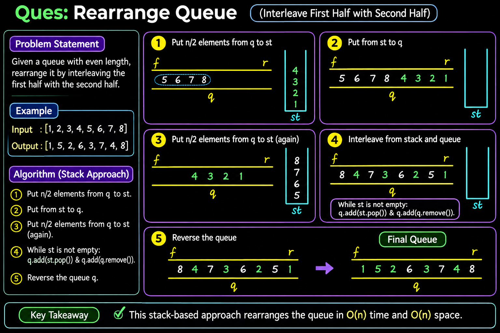

# Pattern 2 - Queue Applications and Rearrangement

**Pattern:** Queue rotation and reversal  
**Data structures:** `Deque<Integer>`, `ArrayDeque<Integer>`, and `Stack` behavior through `Deque`  
**Indexing:** 0-based for index-based operations

## Pattern Overview

A Queue follows **FIFO (First In, First Out)**:

- `Q.remove()` removes the front element.
- `Q.add(value)` adds an element at the rear.
- `Q.peek()` reads the front element without removing it.
- `Q.add(Q.remove())` moves the front element to the rear (one rotation).

A Stack follows **LIFO (Last In, First Out)**:

- `st.push(value)` adds an element to the top.
- `st.pop()` removes and returns the top element.

A stack can reverse the order of Queue elements because the last element pushed is the first one popped.

## Revision Navigation

| No. | Problem                                                   | Main Pattern                                        |
| --: | --------------------------------------------------------- | --------------------------------------------------- |
|   1 | Insert an Element at a Given Index                        | Queue rotation                                      |
|   2 | Remove an Element at a Given Index                        | Queue rotation                                      |
|   3 | Peek at an Element at a Given Index                       | Queue rotation                                      |
|   4 | Reverse a Queue                                           | Queue + Stack                                       |
|   5 | Reverse First K Elements of a Queue                       | Queue + Stack + rotation                            |
|   6 | Josephus Problem — Find the Winner of the Circular Game   | Circular elimination / Queue simulation             |
|   7 | Orderly Queue (LeetCode 899)                              | Queue rotation when `k == 1`; sorting when `k >= 2` |
|   8 | Interleave the First Half of a Queue with the Second Half | Split Queue + alternate elements                    |

---

## 1. Insert an Element at a Given Index

**Assumption:** `0 <= idx <= n`, where `n` is the original Queue size.

### Core Logic

1. Rotate the first `idx` elements to the rear.
2. Add the new element.
3. Rotate the remaining `n - idx` original elements to restore the required order.

### Java Implementation

```java
public static void addEleAtIdx(Deque<Integer> Q, int ele, int idx) {
    int n = Q.size();

    for (int i = 1; i <= idx; i++) {
        Q.add(Q.remove());
    }

    Q.add(ele);

    for (int i = 1; i <= n - idx; i++) {
        Q.add(Q.remove());
    }
}
```

### Dry Run

`Q = [1, 2, 3, 4]`, `ele = 9`, `idx = 2`, `n = 4`.

|  Step | Operation                  | Queue (front → rear) |
| ----: | -------------------------- | -------------------- |
| Start | Original Queue             | `[1, 2, 3, 4]`       |
|     1 | Rotate twice               | `[3, 4, 1, 2]`       |
|     2 | Add `9`                    | `[3, 4, 1, 2, 9]`    |
|     3 | Rotate `n - idx = 2` times | `[1, 2, 9, 3, 4]`    |

**Result:** `[1, 2, 9, 3, 4]`

**Complexity:** `O(n)` time, `O(1)` auxiliary space.

---

## 2. Remove an Element at a Given Index

**Assumption:** `0 <= idx < n`, where `n` is the original Queue size.

### Core Logic

1. Rotate the first `idx` elements to the rear.
2. The target reaches the front; remove it.
3. Rotate the remaining `n - idx - 1` elements to restore the order.

### Java Implementation

```java
public static void removeAtIdx(Deque<Integer> Q, int idx) {
    int n = Q.size();

    for (int i = 1; i <= idx; i++) {
        Q.add(Q.remove());
    }

    Q.remove();

    for (int i = 1; i <= n - idx - 1; i++) {
        Q.add(Q.remove());
    }
}
```

### Dry Run

`Q = [1, 2, 9, 3, 4]`, `idx = 2`, `n = 5`.

|  Step | Operation                      | Queue (front → rear) |
| ----: | ------------------------------ | -------------------- |
| Start | Original Queue                 | `[1, 2, 9, 3, 4]`    |
|     1 | Rotate twice                   | `[9, 3, 4, 1, 2]`    |
|     2 | Remove front (`9`)             | `[3, 4, 1, 2]`       |
|     3 | Rotate `n - idx - 1 = 2` times | `[1, 2, 3, 4]`       |

**Result:** `[1, 2, 3, 4]`

**Complexity:** `O(n)` time, `O(1)` auxiliary space.

---

## 3. Peek at an Element at a Given Index

**Assumption:** `0 <= idx < n`, where `n` is the Queue size.

### Core Logic

1. Rotate the first `idx` elements to the rear.
2. Read the target at the front using `Q.peek()`.
3. Since `peek()` does not remove the target, rotate `n - idx` elements to restore the original order.
4. Return the target value.

### Java Implementation

```java
public static int peekAtIdx(Deque<Integer> Q, int idx) {
    int n = Q.size();

    for (int i = 1; i <= idx; i++) {
        Q.add(Q.remove());
    }

    int top = Q.peek();

    for (int i = 1; i <= n - idx; i++) {
        Q.add(Q.remove());
    }

    return top;
}
```

### Dry Run

`Q = [1, 2, 3, 4, 5]`, `idx = 2`, `n = 5`.

|  Step | Operation                             | Queue (front → rear) |
| ----: | ------------------------------------- | -------------------- |
| Start | Original Queue                        | `[1, 2, 3, 4, 5]`    |
|     1 | Rotate twice                          | `[3, 4, 5, 1, 2]`    |
|     2 | `peek()` returns `3`; Queue unchanged | `[3, 4, 5, 1, 2]`    |
|     3 | Rotate `n - idx = 3` times            | `[1, 2, 3, 4, 5]`    |

**Returned value:** `3`  
**Queue after function:** unchanged.

**Complexity:** `O(n)` time, `O(1)` auxiliary space.

---

## 4. Reverse a Queue

### Core Logic

1. Remove each element from the front of the Queue and push it onto a Stack.
2. Pop each element from the Stack and add it to the rear of the Queue.
3. The Stack's LIFO order reverses the Queue's original order.

### Java Implementation

```java
public static void reverse(Deque<Integer> Q) {
    int n = Q.size();
    Deque<Integer> st = new ArrayDeque<>();

    for (int i = 1; i <= n; i++) {
        st.push(Q.remove());
    }

    for (int i = 1; i <= n; i++) {
        Q.add(st.pop());
    }
}
```

### Dry Run

`Q = [1, 2, 3, 4]` (front → rear)

|  Step | Operation                         | Queue          | Stack (top → bottom) |
| ----: | --------------------------------- | -------------- | -------------------- |
| Start | Initial state                     | `[1, 2, 3, 4]` | `[]`                 |
|     1 | Remove `1`, push                  | `[2, 3, 4]`    | `[1]`                |
|     2 | Remove `2`, push                  | `[3, 4]`       | `[2, 1]`             |
|     3 | Remove `3`, push                  | `[4]`          | `[3, 2, 1]`          |
|     4 | Remove `4`, push                  | `[]`           | `[4, 3, 2, 1]`       |
|     5 | Pop all elements and add to Queue | `[4, 3, 2, 1]` | `[]`                 |

**Result:** `[4, 3, 2, 1]`

**Complexity:** `O(n)` time, `O(n)` auxiliary space for the Stack.

---

## 5. Reverse First K Elements of a Queue

**Assumption:** `0 <= k <= n`, where `n` is the original Queue size.

### Core Logic

1. Remove the first `k` elements from the Queue and push them onto a Stack.
2. Pop those elements and add them to the rear. This reverses the first `k` elements.
3. The original remaining `n - k` elements are now at the front.
4. Rotate those `n - k` elements to the rear so they follow the reversed prefix.

### Java Implementation

```java
public static void reverseKEle(Deque<Integer> Q, int k) {
    int n = Q.size();
    Deque<Integer> st = new ArrayDeque<>();

    for (int i = 1; i <= k; i++) {
        st.push(Q.remove());
    }

    for (int i = 1; i <= k; i++) {
        Q.add(st.pop());
    }

    for (int i = 1; i <= n - k; i++) {
        Q.add(Q.remove());
    }
}
```

### Dry Run

`Q = [1, 2, 3, 4, 5]`, `k = 3`, `n = 5`.

|  Step | Operation                             | Queue (front → rear) | Stack (top → bottom) |
| ----: | ------------------------------------- | -------------------- | -------------------- |
| Start | Initial state                         | `[1, 2, 3, 4, 5]`    | `[]`                 |
|     1 | Remove first 3 and push them          | `[4, 5]`             | `[3, 2, 1]`          |
|     2 | Pop all 3 and add to rear             | `[4, 5, 3, 2, 1]`    | `[]`                 |
|     3 | Rotate remaining `n - k = 2` elements | `[3, 2, 1, 4, 5]`    | `[]`                 |

**Result:** `[3, 2, 1, 4, 5]`

**Complexity:** `O(n)` time, `O(k)` auxiliary space for the Stack.

### Boundary Cases

- `k = 0`: Queue remains unchanged.
- `k = 1`: Queue order remains unchanged.
- `k = n`: The entire Queue is reversed; the final rotation loop runs zero times.
- The function assumes `k` is valid. Validate `k` if values outside `0 <= k <= n` are possible.

---

## Quick Revision

### Restoration Counts

Here, `n` is always the **original Queue size before the operation**.

| Operation             | Main operation | Queue size change | Rotations after main operation |
| --------------------- | -------------- | ----------------: | -----------------------------: |
| Insert at index `idx` | `Q.add(ele)`   |              `+1` |                      `n - idx` |
| Remove at index `idx` | `Q.remove()`   |              `-1` |                  `n - idx - 1` |
| Peek at index `idx`   | `Q.peek()`     |         No change |                      `n - idx` |

### Technique Summary

| Problem                    | Main technique                               |    Auxiliary space |
| -------------------------- | -------------------------------------------- | -----------------: |
| Insert at index            | Queue rotation                               |             `O(1)` |
| Remove at index            | Queue rotation                               |             `O(1)` |
| Peek at index              | Queue rotation                               |             `O(1)` |
| Reverse Queue              | Move all elements through a Stack            |             `O(n)` |
| Reverse first `k` elements | Stack for first `k` + rotate remainder       |             `O(k)` |
| Josephus Problem           | Rotate `k - 1`, remove one, repeat           |             `O(n)` |
| Orderly Queue (`k == 1`)   | Check each rotation; move front to rear      | `O(n)` Queue space |
| Interleave Queue halves    | Helper Deque or Stack + final Queue reversal |             `O(n)` |

### Self-Revision

- [ ] Re-code the five Queue operation functions and the Josephus simulation without looking.
- [ ] Dry-run index operations at the front, middle, and end.
- [ ] Explain why a Stack reverses Queue order.
- [ ] Explain why `reverseKEle()` rotates the remaining `n - k` elements.
- [ ] Check `k = 0`, `k = 1`, and `k = n` for `reverseKEle()`.
- [ ] Dry-run Josephus elimination for a small `n` and `k`.
- [ ] Explain why Orderly Queue has separate cases for `k == 1` and `k >= 2`.
- [ ] Dry-run all rotations for `s = "cba"`, `k = 1`.
- [ ] Explain what `Q.add(Q.remove())` does and why we check the Queue before rotating.
- [ ] Dry-run interleaving the first and second halves of an even-sized Queue.
- [ ] Explain Approach 2 (lecture Stack method): push the first half, pop it back, push the current first half, interleave, then reverse the complete Queue.
- [ ] Explain the time and auxiliary space complexity of each function.

---

## 6. Josephus Problem — Find the Winner of the Circular Game

**Pattern:** Queue Applications → Circular Elimination

**Platform problems:**

- [LeetCode — Find the Winner of the Circular Game](https://leetcode.com/problems/find-the-winner-of-the-circular-game/)
- [Code360 — Predict the Winner](https://www.naukri.com/code360/problems/predict-the-winner_1072979?leftPanelTabValue=PROBLEM)

**Core idea:** Move the first `k - 1` people to the rear of the Queue, remove the `k-th` person, and repeat until one person remains.

### Java implementation (LeetCode)

```java
class Solution {
    public int findTheWinner(int n, int k) {
        Deque<Integer> Q = new ArrayDeque<>();

        for (int i = 1; i <= n; i++) {
            Q.add(i);
        }

        while (Q.size() > 1) {
            for (int i = 1; i <= k - 1; i++) {
                Q.add(Q.remove());
            }

            Q.remove();
        }

        return Q.peek();
    }
}
```

For Code360, use the same Queue logic with the platform's required method signature, `predictTheWinner(int n, int k)`.

### Dry run

For `n = 5`, `k = 2`:

| Step  | Queue after action | Action                   |
| ----- | ------------------ | ------------------------ |
| Start | `[1, 2, 3, 4, 5]`  | Initial Queue            |
| 1     | `[3, 4, 5, 1]`     | Move 1 to rear; remove 2 |
| 2     | `[5, 1, 3]`        | Move 3 to rear; remove 4 |
| 3     | `[3, 5, 1]`        | Move 5 to rear; remove 1 |
| 4     | `[3, 5]`           | Move 3 to rear; remove 5 |
| End   | `[3]`              | Person 3 wins            |

### Complexity

- **Time:** `O(n × k)` — up to `k - 1` rotations for each of the `n - 1` eliminations.
- **Space:** `O(n)` — the Queue stores all `n` people.

**Assumption:** `n >= 1` and `k >= 1`.

**Remember:** This is the Queue simulation approach to the Josephus Problem. The optimized mathematical recurrence is a separate approach.

---

## 7. Orderly Queue — LeetCode 899

**Platform:** [LeetCode — Orderly Queue](https://leetcode.com/problems/orderly-queue/)

**Pattern:** Queue Applications → Queue Rotation

**Problem:** You are given a string `s` and an integer `k`. In one move, choose one of the first `k` characters and append it to the end. Return the lexicographically smallest string possible.

### Recognition Clue

The important question is: **How many characters can we choose from the front?**

There are only two cases:

| Condition | Allowed operation                              | Approach                                        |
| --------- | ---------------------------------------------- | ----------------------------------------------- |
| `k == 1`  | Only the first character can move to the end   | Generate every rotation and choose the smallest |
| `k >= 2`  | We can rearrange the characters into any order | Sort the characters                             |

The problem guarantees `k >= 1`, so after handling `k == 1`, the remaining case is always `k >= 2`.

### Core Intuition

#### Case 1: `k == 1` — Queue rotation

When `k` is `1`, only the front character can be selected. Moving it to the end creates one left rotation.

The Queue operation is:

```java
Q.add(Q.remove());
```

It is equivalent to:

```java
char first = Q.remove(); // Remove the front character
Q.add(first);            // Add that character at the rear
```

Example: `s = "cba"`, `k = 1`

| Check | Queue (front → rear) | Current string | Smallest so far |
| ----: | -------------------- | -------------- | --------------- |
|     1 | `[c, b, a]`          | `cba`          | `cba`           |
|     2 | `[b, a, c]`          | `bac`          | `bac`           |
|     3 | `[a, c, b]`          | `acb`          | `acb`           |

After three rotations, the Queue returns to its original order. We have checked every possible rotation.

**Answer:** `"acb"`

We must check the current Queue **before** rotating it. This makes sure the original string is checked as one of the possible answers.

#### Case 2: `k >= 2` — Sort the characters

When `k` is at least `2`, we can choose from the first two characters. This gives enough flexibility to rearrange the characters into any order. Therefore, the lexicographically smallest result is the sorted string.

Example: `s = "baaca"`, `k = 3`

```text
Original: baaca
Sorted:   aaabc
```

**Answer:** `"aaabc"`

### Java Implementation — Manual String Comparison

This version keeps your Queue rotation approach and compares the current rotation with the smallest string **one character at a time**, without using `compareTo()`.

```java
import java.util.*;

class Solution {
    public String orderlyQueue(String s, int k) {

        if (k == 1) {

            Deque<Character> Q = new ArrayDeque<>();

            for (char ch : s.toCharArray()) {
                Q.add(ch);
            }

            String smallStr = s;

            for (int i = 0; i < s.length(); i++) {

                StringBuilder curr = new StringBuilder();

                for (char ch : Q) {
                    curr.append(ch);
                }

                String currStr = curr.toString();
                boolean isSmallest = false;

                for (int j = 0; j < s.length(); j++) {

                    if (currStr.charAt(j) < smallStr.charAt(j)) {
                        isSmallest = true;
                        break;
                    }

                    if (currStr.charAt(j) > smallStr.charAt(j)) {
                        break;
                    }
                }

                if (isSmallest) {
                    smallStr = currStr;
                }

                Q.add(Q.remove());
            }

            return smallStr;
        }

        // When k > 1, sort the characters
        char[] arr = s.toCharArray();
        Arrays.sort(arr);
        return new String(arr);
    }
}
```

### How the Manual Comparison Works

These lines replace the old `compareTo()` condition:

```java
String currStr = curr.toString();
boolean isSmallest = false;

for (int j = 0; j < s.length(); j++) {

    if (currStr.charAt(j) < smallStr.charAt(j)) {
        isSmallest = true;
        break;
    }

    if (currStr.charAt(j) > smallStr.charAt(j)) {
        break;
    }
}

if (isSmallest) {
    smallStr = currStr;
}
```

The goal is to check whether the current rotation (`currStr`) comes before the saved smallest string (`smallStr`) in dictionary order.

**What each part means:**

1. `currStr = curr.toString()` — Convert the current Queue arrangement into a String.
2. `isSmallest = false` — Initially, do not assume the current string is smaller.
3. `currStr.charAt(j)` — Read the character at position `j` in the current string.
4. `smallStr.charAt(j)` — Read the character at the same position in the saved smallest string.
5. If the current character is smaller, set `isSmallest = true` and stop comparing. The current string wins.
6. If the current character is greater, stop comparing. The current string cannot replace `smallStr`.
7. If both characters are equal, neither condition runs, so the loop checks the next position.
8. After the loop, update `smallStr` only when `isSmallest` is true.

### Manual Comparison Dry Run

Suppose:

```text
currStr = "bac"
smallStr = "cba"
```

Compare from left to right:

| Position (`j`) | `currStr.charAt(j)` | `smallStr.charAt(j)` | What happens?                         |
| -------------: | :-----------------: | :------------------: | ------------------------------------- |
|              0 |         `b`         |         `c`          | `b < c`, so `isSmallest = true`; stop |

Now:

```java
smallStr = currStr;
```

So `smallStr` becomes `"bac"`.

Another example:

```text
currStr = "cba"
smallStr = "bac"
```

At position `0`, `c > b`. The loop stops, `isSmallest` remains `false`, and `smallStr` stays `"bac"`.

**What if characters are equal?**

For:

```text
currStr = "abc"
smallStr = "abd"
```

- Position 0: `a == a` → continue.
- Position 1: `b == b` → continue.
- Position 2: `c < d` → current string is smaller.

### Why Do We Stop at the First Different Character?

Dictionary order is decided by the first position where two strings differ. Once we find that position, later characters cannot change the result.

- Current character `<` saved character → current string is smaller.
- Current character `>` saved character → current string is greater.
- Characters are equal → move to the next position.

All rotations have the same length as the original string, so comparing positions up to `s.length()` is safe.

### Alternative — Using `compareTo()`

Instead of writing the character-by-character comparison yourself, Java provides `String.compareTo()` to do the same lexicographical comparison.

Replace the manual comparison block:

```java
String currStr = curr.toString();
boolean isSmallest = false;

for (int j = 0; j < s.length(); j++) {

    if (currStr.charAt(j) < smallStr.charAt(j)) {
        isSmallest = true;
        break;
    }

    if (currStr.charAt(j) > smallStr.charAt(j)) {
        break;
    }
}

if (isSmallest) {
    smallStr = currStr;
}
```

With this shorter alternative:

```java
String currStr = curr.toString();

if (currStr.compareTo(smallStr) < 0) {
    smallStr = currStr;
}
```

#### What Does `compareTo()` Do?

`compareTo()` compares two strings from left to right, just like the manual loop:

- It checks the first characters.
- If they are equal, it checks the next characters.
- At the first different character, it decides which string is smaller.
- It returns a negative number when the calling string is smaller, `0` when both strings are equal, and a positive number when the calling string is greater.

Example:

```java
String currStr = "bac";
String smallStr = "cba";

currStr.compareTo(smallStr) < 0
```

The first characters are `b` and `c`. Since `b` comes before `c`, `"bac"` is smaller, so the condition is true and `smallStr` is updated to `"bac"`.

#### Manual Comparison vs `compareTo()`

| Point            | Manual character comparison              | `compareTo()`                           |
| ---------------- | ---------------------------------------- | --------------------------------------- |
| How it works     | You compare characters using `charAt(j)` | Java compares the strings internally    |
| Code length      | More code                                | Shorter code                            |
| Readability      | Shows the comparison logic clearly       | Easier to read once you know the method |
| Time complexity  | `O(n)` per comparison                    | `O(n)` per comparison                   |
| Practical choice | Useful for learning how comparison works | Usually preferable in normal Java code  |

**Does `compareTo()` make the whole solution faster?**

No meaningful asymptotic improvement. Both methods may need to inspect up to `n` characters for one comparison. Since the Queue solution checks `n` rotations, the `k == 1` case remains `O(n²)` either way.

**Which one should you use?**

- While learning: practise the manual version to understand why the first different character decides the result.
- In a normal interview or production solution: use `compareTo()` because it is shorter and easier to maintain.

Both versions produce the same answer. You only need one of them in the submitted code; do not use both comparison blocks together.

### Remaining Code: Queue Rotation and Sorting

**For `k == 1`:**

1. `Deque<Character> Q = new ArrayDeque<>();` — Create a Queue to store the characters.
2. The first `for` loop inserts every character of `s` into the Queue.
3. `String smallStr = s;` — Start with the original string as the best answer found so far.
4. The outer loop runs `s.length()` times to check all rotations, including the original order.
5. `StringBuilder curr = new StringBuilder();` — Prepare the current Queue arrangement as a string.
6. `for (char ch : Q)` — Read the Queue from front to rear and append each character. This iteration does not remove anything.
7. The manual comparison checks whether `currStr` is smaller than `smallStr`, one character at a time. See the detailed comparison section above.
8. If `isSmallest` is true, update `smallStr`.
9. `Q.add(Q.remove());` — Remove the front character and append it at the rear to create the next rotation.
10. After checking all rotations, return `smallStr`.

**For `k >= 2`:**

1. `s.toCharArray()` converts the String into a character array.
2. `Arrays.sort(arr)` sorts the characters in ascending order.
3. `new String(arr)` converts the sorted array back into a String.

### Important Note — Why Manual Comparison Works

The problem gives lowercase English letters, and all candidate rotations have the same length. We can therefore compare the characters at matching positions from left to right. The first different character decides which string is smaller. If every position is equal, both strings are identical and there is no need to update `smallStr`.

### Complexity Analysis

Let `n` be the length of `s`.

| Case     | Time complexity | Auxiliary space |
| -------- | --------------: | --------------: |
| `k == 1` |         `O(n²)` |          `O(n)` |
| `k >= 2` |    `O(n log n)` |          `O(n)` |

**Why is the `k == 1` case `O(n²)`?**

- There are `n` rotations.
- For each rotation, we traverse the Queue and build a string in `O(n)` time.
- Therefore, `n × O(n) = O(n²)`.

### Two Equivalent Ways to Write the Conditions

Both implementations are correct. They handle the same two cases, but in a different order.

#### 1. Handle the special case first

```java
if (k == 1) {
    // Queue rotation logic
}

// Otherwise, sort
char[] arr = s.toCharArray();
Arrays.sort(arr);
return new String(arr);
```

Here, we first handle the special case `k == 1`. If that condition is false, execution continues to the sorting code.

#### 2. Handle the sorting case first

```java
if (k >= 2) {
    // Sort
    char[] arr = s.toCharArray();
    Arrays.sort(arr);
    return new String(arr);
}

// Otherwise, Queue rotation logic
```

Here, we first handle `k >= 2`. If that condition is false, execution continues to the Queue rotation code.

#### Are They Equivalent?

Yes. The problem constraints guarantee `k >= 1`. Therefore, when `k == 1` is false, `k` must be 2 or greater.

| `k` | First implementation (`k == 1` first) | Second implementation (`k >= 2` first) |
| --: | ------------------------------------- | -------------------------------------- |
|   1 | Queue rotation                        | Queue rotation                         |
|   2 | Sorting                               | Sorting                                |
|   3 | Sorting                               | Sorting                                |
|   4 | Sorting                               | Sorting                                |

#### Efficiency Comparison

Both implementations perform exactly the same work for each value of `k`.

| Complexity | First implementation | Second implementation |
| ---------- | -------------------: | --------------------: |
| `k == 1`   |              `O(n²)` |               `O(n²)` |
| `k >= 2`   |         `O(n log n)` |          `O(n log n)` |
| Worst case |              `O(n²)` |               `O(n²)` |
| Space      |               `O(n)` |                `O(n)` |

**Conclusion:** Changing the order of the `if` condition does not improve efficiency. Choose the structure that is easier for you to read. The second structure checks the sorting case first and returns early; the first structure handles the special Queue case first.

### Common Mistakes

- Sorting when `k == 1`. With `k == 1`, we can only rotate; we cannot freely rearrange the characters.
- Checking only `k == 2` or `k == 3`. Use `k >= 2` because sorting works for every `k` greater than or equal to `2`.
- Writing `arrays.sort(arr)`. Java uses the capitalized class name: `Arrays.sort(arr)`.
- Rotating before checking the current Queue. Check first so the original string is included.
- Using two Queues or splitting the string into halves. Neither is required for this problem.

### Quick Recall

```text
k == 1  → Queue rotation → Compare all rotations
k >= 2  → Sort characters → Return sorted string
```

**Remember:** `Q.add(Q.remove())` removes the front character and appends it at the rear. For `k == 1`, repeat this rotation `n` times while checking each Queue arrangement.

---

## 8. Interleave the First Half of a Queue with the Second Half

**Platform:**

- [Code360 — Interleave the First Half of the Queue with the Second Half](https://www.naukri.com/code360/problems/interleave-the-first-half-of-the-queue-with-the-second-half_1169450?count=25&search=&sort_entity=order&sort_order=ASC&leftPanelTabValue=SUBMISSION)
- [GeeksforGeeks — Interleave the First Half of the Queue with the Second Half](https://www.geeksforgeeks.org/problems/interleave-the-first-half-of-the-queue-with-second-half/1)

**Pattern:** Queue Applications → Splitting and Rearrangement

**Problem:** Given an even-sized Queue, rearrange it by alternating elements from the first half and the second half.

Example:

```text
Input:  [1, 2, 3, 4, 5, 6]
Output: [1, 4, 2, 5, 3, 6]
```

### Core Intuition

We need the final Queue to contain:

```text
First half:  1, 2, 3
Second half: 4, 5, 6

Final:       1, 4, 2, 5, 3, 6
```

The steps are:

1. Move the first half of the Queue into a helper Deque.
2. The original Queue now contains the second half.
3. Take one element from the helper Deque and add it to the rear of the original Queue.
4. Move the front element of the original Queue to its rear. This takes the next element from the second half and places it after the first-half element.
5. Repeat until the helper Deque becomes empty.

### Approach 1 — Helper Deque (My Code)

```java
class Solution {
    public void rearrangeQueue(Queue<Integer> q) {

        Deque<Integer> Qhelp = new ArrayDeque<>();

        int half = q.size() / 2;

        // Move first half into helper Deque
        for (int i = 1; i <= half; i++) {
            Qhelp.add(q.remove());
        }

        // Interleave both halves
        while (!Qhelp.isEmpty()) {
            q.add(Qhelp.remove());
            q.add(q.remove());
        }
    }
}
```

### Dry Run

Input:

```text
q = [1, 2, 3, 4, 5, 6]
```

**Step 1 — Move the first half into `Qhelp`**

The loop runs `n / 2 = 3` times.

```text
Qhelp = [1, 2, 3]
q     = [4, 5, 6]
```

**Step 2 — Interleave the two halves**

Each loop iteration performs these two operations:

```java
q.add(Qhelp.remove());
q.add(q.remove());
```

- First line: take the next element from the first half and add it to the rear.
- Second line: take the front element from the remaining second half and move it to the rear.

| Iteration | After `q.add(Qhelp.remove())` | After `q.add(q.remove())` |
| --------: | ----------------------------- | ------------------------- |
|         1 | `[4, 5, 6, 1]`                | `[5, 6, 1, 4]`            |
|         2 | `[5, 6, 1, 4, 2]`             | `[6, 1, 4, 2, 5]`         |
|         3 | `[6, 1, 4, 2, 5, 3]`          | `[1, 4, 2, 5, 3, 6]`      |

<text>Final Queue:</text>

```text
[1, 4, 2, 5, 3, 6]
```

### Understand the Two Important Operations

```java
q.add(Qhelp.remove());
```

Take the next element from the helper Deque and append it to the original Queue.

```java
q.add(q.remove());
```

Remove the front element of the original Queue and append it at the rear. In this algorithm, that front element is the next unused element from the second half.

### Why Does the Loop Use `!Qhelp.isEmpty()`?

The helper Deque stores exactly the first half, which has `n / 2` elements.

Each iteration removes one element from `Qhelp`, so the loop runs exactly `n / 2` times. During every iteration, one element from each half is placed into the interleaved order.

### Complexity Analysis

Let `n` be the total number of elements in the Queue.

| Operation                        | Complexity |
| -------------------------------- | ---------: |
| Move the first half into `Qhelp` |     `O(n)` |
| Interleave both halves           |     `O(n)` |
| Total time                       |     `O(n)` |
| Auxiliary space for `Qhelp`      |     `O(n)` |

Each Queue/Deque insertion and removal takes `O(1)` time. We perform a linear number of operations, so the total time is `O(n)`.

### Important Assumption

This implementation assumes the Queue has an **even number of elements**, as required by this interleaving problem. The two halves must have the same number of elements.

### Quick Recall

```text
Split first half
      ↓
Store it in Qhelp
      ↓
Take one from Qhelp → add to original Queue
      ↓
Move one from original Queue front → rear
      ↓
Repeat until Qhelp is empty
```

**Remember:** `q.add(q.remove())` rotates the front element to the rear. Here, it is used to place one element from the second half immediately after each element taken from the first half.

### Approach 2 — Stack + Final Queue Reversal (Lecture Method)

This is the Stack-based method shown in your lecture image. It uses one Stack and the original Queue. Instead of rotating the Queue, it interleaves the elements first and then reverses the complete Queue. The five steps are:

1. Pushes the original first half into the Stack.
2. Pops those elements back into the Queue.
3. Pushes the first half of the current Queue (which is now the original second half) into the Stack.
4. Interleaves the Stack and Queue.
5. Reverses the complete Queue using the Stack to obtain the required order.

**Why is the final reversal needed?** Step 4 creates the interleaved elements in reverse order. Step 5 reverses the complete Queue to produce the required arrangement.

#### Problem Example

```text
Input Queue:  [1, 2, 3, 4, 5, 6, 7, 8]
Expected:     [1, 5, 2, 6, 3, 7, 4, 8]
```

Let the first half be `[1, 2, 3, 4]` and the second half be `[5, 6, 7, 8]`.

#### Step-by-Step Explanation

**Step 1 — Push the original first half into the Stack**

```java
for(int i = 1; i <= half; i++){
    st.push(q.remove());
}
```

Remove `1, 2, 3, 4` from the Queue and push them into the Stack.

```text
Queue (front → rear): [5, 6, 7, 8]

Stack (top → bottom):
4
3
2
1
```

**Step 2 — Pop the Stack back into the Queue**

```java
while(!st.isEmpty()){
    q.add(st.pop());
}
```

The Stack follows LIFO, so the elements return in the order `4, 3, 2, 1`.

```text
Queue: [5, 6, 7, 8, 4, 3, 2, 1]
Stack: empty
```

**Step 3 — Push the first half of the current Queue into the Stack**

```java
for(int i = 1; i <= half; i++){
    st.push(q.remove());
}
```

Be careful: the current Queue has changed. Its first four elements are now the **original second half** (`5, 6, 7, 8`).

```text
Queue: [4, 3, 2, 1]

Stack (top → bottom):
8
7
6
5
```

**Step 4 — Interleave the Stack and Queue**

```java
while(!st.isEmpty()){
    q.add(st.pop());
    q.add(q.remove());
}
```

Each iteration does two operations:

1. Pop one element from the Stack and add it to the rear of the Queue.
2. Remove the current front element of the Queue and add it to the rear.

Dry run:

| Iteration | After adding Stack element | After rotating Queue front |
| --------: | -------------------------- | -------------------------- |
|     Start | —                          | `[4, 3, 2, 1]`             |
|         1 | `[4, 3, 2, 1, 8]`          | `[3, 2, 1, 8, 4]`          |
|         2 | `[3, 2, 1, 8, 4, 7]`       | `[2, 1, 8, 4, 7, 3]`       |
|         3 | `[2, 1, 8, 4, 7, 3, 6]`    | `[1, 8, 4, 7, 3, 6, 2]`    |
|         4 | `[1, 8, 4, 7, 3, 6, 2, 5]` | `[8, 4, 7, 3, 6, 2, 5, 1]` |

After Step 4, the Queue is:

```text
[8, 4, 7, 3, 6, 2, 5, 1]
```

This is the reverse of the required answer. That is why the final reversal is necessary.

**Step 5 — Reverse the complete Queue using the Stack**

First, move every Queue element into the Stack:

```java
while(!q.isEmpty()){
    st.push(q.remove());
}
```

Then pop every Stack element back into the Queue:

```java
while(!st.isEmpty()){
    q.add(st.pop());
}
```

```text
Queue before reversal: [8, 4, 7, 3, 6, 2, 5, 1]

Stack after pushing all Queue elements
(top → bottom):
1
5
2
6
3
7
4
8

Queue after popping everything back:
[1, 5, 2, 6, 3, 7, 4, 8]
```

#### Java Implementation — Stack + Final Queue Reversal

The following is the lecture implementation you shared, preserved as provided:

```java
import java.util.* ;
import java.io.*;
import java.util.Queue;

public class Solution {
    public static void interLeaveQueue(Queue < Integer > q) {

        Deque<Integer> st = new ArrayDeque<>();
        int half = q.size() / 2;

        for(int i = 1; i <= half; i++){
            st.push(q.remove());
        }

        while(!st.isEmpty()){
            q.add(st.pop());
        }

        for(int i = 1; i <= half; i++){
            st.push(q.remove());
        }

        while(!st.isEmpty()){
            q.add(st.pop());
            q.add(q.remove());
        }

        while(!q.isEmpty()){
            st.push(q.remove());
        }

        while(!st.isEmpty()){
            q.add(st.pop());
        }

    }
}
```

**What each part is doing:**

| Code part                 | Purpose                                                |
| ------------------------- | ------------------------------------------------------ |
| First `for` loop          | Push the original first half into the Stack            |
| First `while` loop        | Restore those elements to the Queue in reverse order   |
| Second `for` loop         | Push the original second half into the Stack           |
| Interleaving `while` loop | Build the required pairs, but in reverse overall order |
| Last two `while` loops    | Reverse the complete Queue to get the final answer     |

**Import note:** `java.util.*` already includes `Queue` and `Deque`, so `import java.util.Queue;` is redundant. `java.io.*` is not used here. These imports are harmless, and they have been retained because the submitted code is being preserved.

#### Complexity Analysis

Let `n` be the total number of Queue elements.

| Step                               | Work                            |       Time |
| ---------------------------------- | ------------------------------- | ---------: |
| Push first half into Stack         | `n / 2` elements                |     `O(n)` |
| Pop Stack back into Queue          | `n / 2` elements                |     `O(n)` |
| Push current first half into Stack | `n / 2` elements                |     `O(n)` |
| Interleave                         | `n / 2` iterations              |     `O(n)` |
| Move whole Queue into Stack        | `n` elements                    |     `O(n)` |
| Move Stack back into Queue         | `n` elements                    |     `O(n)` |
| **Total**                          | A fixed number of linear passes | **`O(n)`** |

**Auxiliary space:** `O(n)` because the Stack stores up to `n` elements during the final reversal.

#### Important Assumption

Both approaches assume the Queue has an **even number of elements**, so both halves contain the same number of elements.

#### Compare All Three Approaches

| Point                  | Approach 1: Helper Deque                 | Approach 2: Stack + final Queue reversal                                                              |
| ---------------------- | ---------------------------------------- | ----------------------------------------------------------------------------------------------------- |
| Extra structure        | Helper Deque                             | Stack implemented using `Deque`                                                                       |
| Main idea              | Store first half, then alternate         | Push first half, restore it, push the current first half, interleave, then reverse the complete Queue |
| Final Queue reversal   | Not needed                               | Required                                                                                              |
| Time complexity        | `O(n)`                                   | `O(n)`                                                                                                |
| Auxiliary space        | `O(n)`                                   | `O(n)`                                                                                                |
| Main thing to remember | Alternate helper element and Queue front | Interleave first, then reverse the complete Queue                                                     |

**Which should you prefer?**

- Learn the helper-Deque solution to see how the two halves can be alternated directly.
- Learn the lecture Stack method (Approach 2): it interleaves the Queue and then reverses the complete Queue.
- Both approaches have `O(n)` time and `O(n)` auxiliary space.

### Stack-Based Interleaving

The diagram below shows the complete five-step Stack method, including the intermediate Queue states and the final reversal.



**Key point:** Step 4 creates the interleaved sequence in reverse order. Step 5 reverses the whole Queue to obtain `[1, 5, 2, 6, 3, 7, 4, 8]`.

### Final Pattern Recall — Interleave Queue Halves

```text
Approach 1 — Helper Deque:
Store first half → Alternate helper element and Queue front

Approach 2 — Stack + final Queue reversal:
Push first half → Pop back → Push current first half
→ Interleave → Reverse the complete Queue
```

Both approaches produce the same interleaved order for an even-sized Queue.
