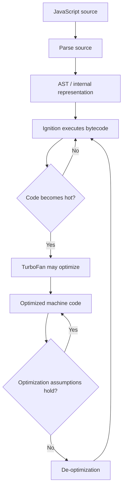

# 01 — Node.js Runtime and V8

## 1. Three terms to distinguish

| Term | Meaning |
|---|---|
| **JavaScript** | The programming language |
| **V8** | JavaScript engine that parses and executes JavaScript |
| **Node.js** | Runtime that embeds V8 and adds server-side APIs |
| **libuv** | Library used by Node.js for the event loop, OS I/O integration and selected worker-pool tasks |

**Interview answer:** V8 executes JavaScript; Node.js provides the runtime; libuv helps coordinate asynchronous operations. The event loop is covered in Lecture 04.

## 2. How V8 executes code

- **Parsing:** checks syntax and builds an internal representation such as an Abstract Syntax Tree (AST).
- **Ignition:** V8's interpreter executes bytecode.
- **TurboFan:** may optimize frequently executed (“hot”) code.
- **De-optimization:** V8 can leave optimized code when assumptions are no longer valid.
- **Garbage collection (GC):** reclaims memory associated with objects that are no longer reachable.

This is a simplified pipeline; actual V8 execution uses multiple tiers and implementation details can change.

## 3. Memory basics

| Concept | Interview-level meaning |
|---|---|
| Call stack | Tracks active function calls and execution state |
| Heap | Commonly stores dynamically allocated objects |
| Garbage collection | Automatically reclaims unreachable objects |
| Memory leak | Memory remains retained when the program no longer needs it |

Avoid saying every JavaScript variable is always physically stored on a particular stack or heap location; V8 can optimize how values are represented.

## 4. Why Node.js needs a runtime

V8 executes JavaScript but does not, by itself, provide all server capabilities. Node.js adds APIs for files, networking, processes and other system tasks. Browser-only objects such as `window` and `document` are not normally available in Node.js.

## Interview checks

**What is the difference between V8 and Node.js?**  
V8 is the engine; Node.js embeds it and provides runtime APIs.

**What is an AST?**  
A structured representation of source code produced during parsing.

**What is de-optimization?**  
The engine abandons an optimization when assumptions behind it no longer hold.

**What is garbage collection?**  
Automatic reclamation of memory used by objects that are no longer reachable.

**Why can a Node.js app use too much memory?**  
It may retain unnecessary objects, cache too much data or keep references that prevent GC from reclaiming memory.

## Remember

**Language = JavaScript · Engine = V8 · Runtime = Node.js · Async infrastructure = libuv + OS facilities.**
