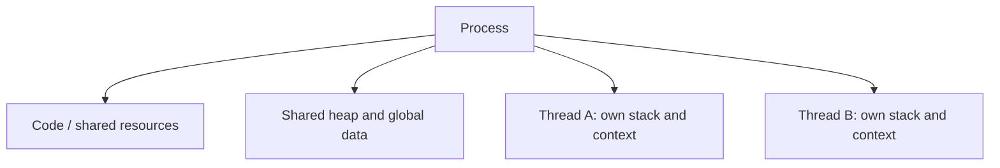

# 02 — Processes, Threads and Concurrency

## 1. Program vs. process vs. thread

| Term | Meaning |
|---|---|
| Program | Code stored on disk |
| Process | Running instance of a program |
| Thread | Execution path within a process |
| PID | Process identifier |
| PCB | Operating-system data used to manage a process |
| Program counter | Tracks the instruction position for an execution context |

## 2. Process memory and thread sharing

A simplified process memory model includes code, heap, stack and global/static data. Details vary by OS, language and runtime.

Threads inside a process normally share the address space and many resources, but each thread has its own stack and CPU execution context.

| Separate processes | Threads in one process |
|---|---|
| Normally separate address spaces | Share process address space |
| Often need IPC for communication | Can share data directly |
| Stronger isolation | Shared data can produce race conditions |
| Generally greater resource overhead | Generally lighter, but still has overhead |

A **race condition** occurs when concurrent access to shared state makes the result depend on timing or execution order.

## 3. Scheduling and context switching

The OS scheduler chooses which runnable thread gets CPU time. A **context switch** saves one execution context and restores another.

Context switching enables the CPU to share time across tasks, but switching has overhead.

## 4. Concurrency vs. parallelism

- **Concurrency:** multiple tasks are in progress over overlapping periods; they may take turns or wait.
- **Parallelism:** multiple tasks execute at the same instant on separate execution resources.
- A single core can share CPU time among multiple threads, but does not run them all in parallel at the same instant.
- Multiple cores can execute tasks in parallel.

## 5. CPU-bound vs. I/O-bound

| Workload | Main bottleneck | Example |
|---|---|---|
| CPU-bound | Computation | Video transcoding, heavy image processing |
| I/O-bound | Waiting for input/output | Database response, network or file operation |

I/O-heavy applications often benefit from asynchronous designs. CPU-heavy JavaScript may need better algorithms, worker threads or separate processes.

## 6. Scaling

| Approach | Meaning |
|---|---|
| Vertical scaling | Add resources to one machine, such as CPU or RAM |
| Horizontal scaling | Add more machines or application instances |

More CPU does not automatically fix slow database queries, excessive network latency or inefficient algorithms.

## Interview checks

**What is a process?** A running program instance managed by the OS.

**What is a thread?** An execution path within a process.

**What is a context switch?** Saving one execution context and restoring another.

**Concurrency vs. parallelism?** Overlapping progress vs. execution at the same instant.

**Why can threads cause race conditions?** Threads share data, and unsynchronized concurrent access can produce timing-dependent results.

**Why are threads often called lightweight compared with processes?** They reuse many resources of the same process instead of requiring a separate address space.

## Remember

Processes provide isolation; threads provide multiple execution paths. Concurrency and parallelism are related but not interchangeable.
