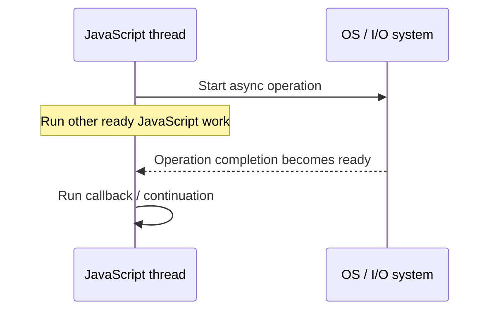

# 03 — Is Node.js Single-Threaded?

## 1. The correct interview answer

Node.js is often called **single-threaded** because application JavaScript callbacks generally execute on one main event-loop thread per isolate. However, the complete Node.js runtime is not limited to one thread.

It also relies on operating-system I/O facilities, a libuv worker pool for selected operations, and optional `worker_threads` or child processes.

## 2. What happens during asynchronous I/O?



**Non-blocking does not mean instant.** It means the JavaScript thread does not have to wait synchronously while the operation is pending.

## 3. Which operations use which mechanism?

| Operation | Typical mechanism |
|---|---|
| Network socket I/O | OS asynchronous/event-notification facilities |
| Many file-system APIs | Often uses the libuv worker pool |
| Some crypto/compression work | Often uses the libuv worker pool |
| CPU-heavy JavaScript loop | Runs on the current JavaScript thread unless moved elsewhere |
| CPU-heavy JavaScript in `worker_threads` | Can execute on another JavaScript thread |

The exact implementation depends on the API and platform. **Not all asynchronous operations use the thread pool.**

The libuv worker pool commonly has four threads by default. `UV_THREADPOOL_SIZE` can configure it before the pool is initialized; increasing it does not guarantee better performance.

## 4. Blocking vs. non-blocking example

```js
import { readFileSync, readFile } from "node:fs";

// Blocks the JavaScript thread until the read finishes.
const text = readFileSync("./data.txt", "utf8");
console.log(text);

// Callback runs when the asynchronous read completes.
readFile("./data.txt", "utf8", (err, data) => {
  if (err) return console.error(err);
  console.log(data);
});
```

Avoid synchronous operations that can take significant time in server request paths because they delay unrelated JavaScript callbacks.

## 5. Thread pool vs. worker thread vs. child process

| Mechanism | Use |
|---|---|
| libuv worker pool | Runtime-managed workers for selected native operations |
| `worker_threads` | Additional JavaScript execution threads; useful for CPU-intensive JS |
| Child process | Separate OS process with separate memory space and stronger isolation |

Do not confuse `worker_threads` with the libuv pool.

## 6. Server-architecture comparison

Traditional process/thread-per-connection approaches can consume significant resources at high concurrency. Event-driven servers such as Nginx can manage many connections with a small number of workers.

This is a high-level comparison, not a universal rule: Apache supports multiple process/thread configurations.

## Interview checks

**Is Node.js single-threaded?** JavaScript callbacks generally run on a main event-loop thread per isolate, but the runtime can use worker-pool threads, worker threads, OS I/O and child processes.

**Will every database call use a libuv thread?** No. Network socket I/O is commonly managed through OS networking facilities; selected APIs use the pool.

**What blocks the event loop?** Long synchronous JavaScript, CPU-heavy loops and synchronous operations on the event-loop thread.

**When should you consider `worker_threads`?** For CPU-intensive JavaScript work that should not occupy the main event-loop thread.

**Does increasing `UV_THREADPOOL_SIZE` always improve performance?** No; it depends on workload and available resources.

## Remember

Node.js can handle many concurrent I/O operations without creating one JavaScript thread per request. CPU-heavy work needs separate consideration.
