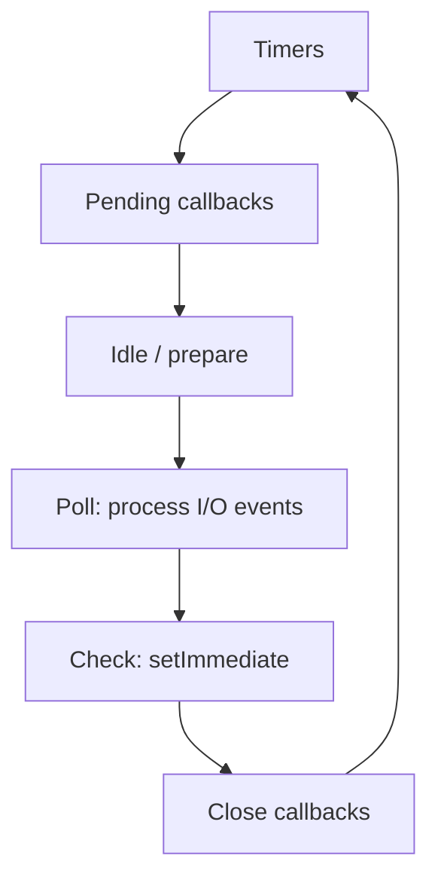

# 04 — libuv, Event Loop and Microtasks

## 1. Core idea

V8 executes JavaScript. Node.js and **libuv** coordinate asynchronous operations and schedule callbacks when work is ready. A callback normally runs on the JavaScript thread; asynchronous APIs do not automatically make the callback execute in parallel.

## 2. Event-loop phases



| Phase | Purpose |
|---|---|
| Timers | Eligible `setTimeout()` / `setInterval()` callbacks |
| Pending callbacks | Certain deferred system/I/O callbacks |
| Idle / prepare | Internal libuv work |
| Poll | Retrieve and process I/O events; can wait for I/O |
| Check | `setImmediate()` callbacks |
| Close callbacks | Some close-event callbacks |

This is a simplified phase diagram. Timing and exact callback ordering depend on Node.js version and execution context.

## 3. Microtasks and `process.nextTick()`

- Promise handlers (`then`, `catch`, `finally`) run as microtasks.
- `process.nextTick()` uses Node.js's next-tick queue.
- In common CommonJS callback contexts, the next-tick queue is drained before Promise microtasks.
- These queues are not additional libuv phases like poll or check.

### One worked dry run

Run this example as CommonJS (for example, in a `.cjs` file) for the output below.

```js
console.log("A");

process.nextTick(() => console.log("nextTick"));
Promise.resolve().then(() => console.log("promise"));

console.log("B");
```

**Output:**

```text
A
B
nextTick
promise
```

**Trace:**

| Step | What happens | Output |
|---:|---|---|
| 1 | First synchronous log runs | `A` |
| 2 | `nextTick` callback is queued | — |
| 3 | Promise handler is queued | — |
| 4 | Second synchronous log runs | `B` |
| 5 | Current synchronous code finishes; Node drains next-tick callbacks | `nextTick` |
| 6 | Promise microtask runs | `promise` |

This trace is for ordinary top-level CommonJS execution. Module type and context can affect details.

## 4. `setTimeout(0)` vs. `setImmediate()`

- `setTimeout(fn, 0)` schedules a timer after a minimum threshold; it is not immediate.
- `setImmediate(fn)` runs in the check phase.
- From an I/O callback, `setImmediate()` commonly runs before a newly scheduled zero-delay timer.
- At top level, their relative order can vary; do not memorize a universal order.

## 5. Where libuv fits

libuv provides the event loop, cross-platform I/O integration and a worker pool for selected work. Network sockets commonly use OS event notification; many file-system operations and selected crypto/compression/DNS lookup operations can use the worker pool.

**Trap:** not every asynchronous operation uses the libuv thread pool.

## Interview checks

**What is the event loop?** The mechanism coordinating asynchronous work and running callbacks/continuations when appropriate.

**What is the poll phase?** A phase that handles I/O events and can wait for I/O.

**What is the check phase?** The phase for `setImmediate()` callbacks.

**Is `setTimeout(fn, 0)` immediate?** No; the callback runs when eligible and when the loop can process it.

**How can the event loop be blocked?** By long-running synchronous JavaScript or blocking APIs.

## Remember

Know the phase names, distinguish next-tick/Promise microtasks from phases, and avoid claiming that timers always run in a fixed order.
