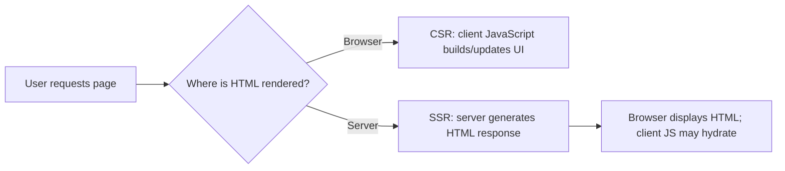

# 06 — File I/O, Paths and Rendering

## 1. File-system APIs

Node.js's built-in `fs` module supports file read/write/append/delete/watch operations.

| API | Completion style |
|---|---|
| `node:fs` | Common callback-based functions |
| `node:fs/promises` | Promise-based functions for `async`/`await` |

Example:

```js
import { readFile } from "node:fs/promises";

const text = await readFile(new URL("./data.txt", import.meta.url), "utf8");
console.log(text);
```

- With `"utf8"`, the result is a string.
- Without an encoding, `readFile()` returns a `Buffer`.
- Synchronous APIs block the JavaScript thread; asynchronous APIs let it handle other work while the operation is pending.

## 2. Module paths

| Expression | Meaning |
|---|---|
| `__dirname` | Directory of the current CommonJS module |
| `import.meta.url` | URL of the current ES module |
| `process.cwd()` | Current working directory of the process |
| `new URL("./file.html", import.meta.url)` | Resolve a file relative to the ESM file |
| `join()` from `node:path` | Build a filesystem path |

`process.cwd()` can differ from the directory containing the current script. Use a module-relative path for files shipped alongside the module.

## 3. Top-level `await`

ES modules support top-level `await`. In CommonJS, put the `await` inside an `async` function.

```js
// ESM
const text = await readFile("./data.txt", "utf8");
```

## 4. Templating

A **template** contains reusable content and placeholders. A **templating engine** combines the template with data to generate output, often HTML. Examples include EJS and Handlebars.

```html
<h1>Hello, <%= name %></h1>
```

With a compatible EJS renderer and data `{ name: "Om" }`, the placeholder is replaced with the provided value.

**Security:** use a template engine's escaping features. Inserting untrusted values as raw HTML can cause cross-site scripting (XSS).

## 5. CSR vs. SSR



| CSR | SSR |
|---|---|
| Much of the UI is rendered in the browser | Server generates HTML for the request |
| Depends on client-side JavaScript for much of UI | Browser receives rendered HTML; JavaScript may still run afterwards |
| Often used for interactive web apps | Can provide useful initial HTML before client code completes |

Templating and SSR are related but not identical. A local script writing HTML is not by itself a complete SSR request; SSR includes rendering for a client request and sending the response.

## Interview checks

**What happens without an encoding in `readFile()`?** A `Buffer` is returned.

**Why avoid synchronous file I/O in a request handler?** It blocks the JavaScript thread and can delay other callbacks.

**`process.cwd()` vs. `__dirname`?** Working directory of the process vs. directory of the CommonJS module.

**What is a templating engine?** A tool that combines a template and data to generate output.

**CSR vs. SSR?** Browser-side rendering vs. server-generated HTML.

**What is XSS?** Treating untrusted content as executable page content; escape data and avoid unsafe raw HTML.

## Remember

Focus on async vs. sync file I/O, ESM vs. CommonJS paths, and the difference between templates, CSR and SSR.
