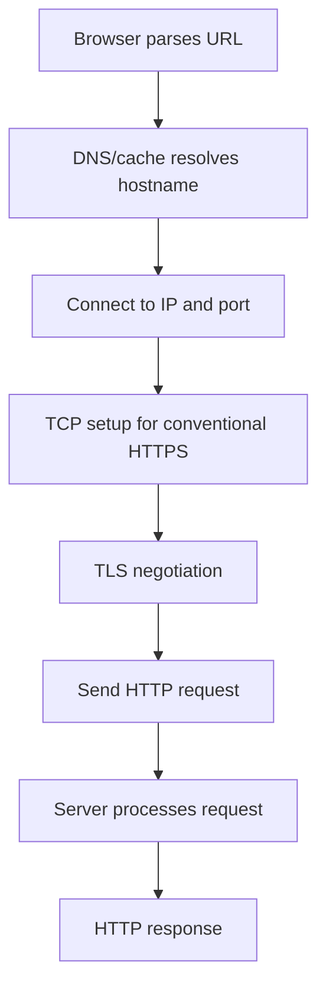
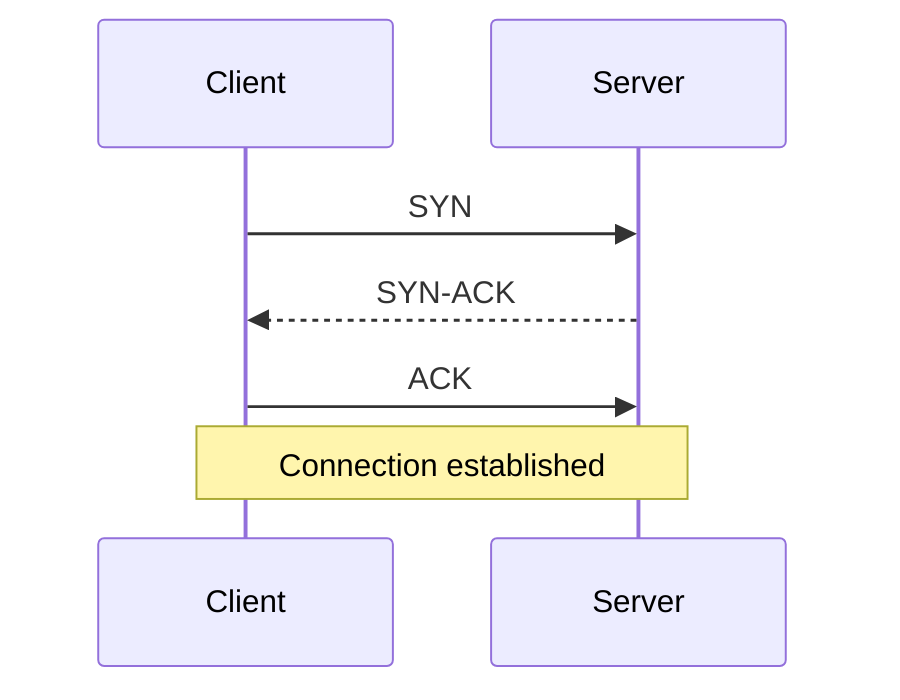

# 07 — Networking: DNS, TCP/IP and Ports

## 1. Terms to distinguish

| Term | Meaning |
|---|---|
| Domain | Human-readable name such as `example.com` |
| URL | Resource locator that may include scheme, host, port and path |
| IP address | Address used for IP communication |
| DNS | Distributed naming system that resolves names to records |
| Protocol | Rules and message formats for communication |
| Port | Logical transport endpoint identifier |

## 2. What happens when a browser opens a website?

An existing connection may be reused and DNS answers may be cached. HTTP/3 uses QUIC over UDP rather than TCP, so not every web request follows the exact TCP/TLS path shown.

## 3. DNS basics

A configured recursive resolver can query the DNS hierarchy—including root, top-level-domain (TLD) and authoritative servers—to find records. Results can be cached according to their TTL.

A domain may resolve to multiple IP addresses for availability or traffic distribution. DNS records need to be configured to direct a domain to the intended service; buying a domain alone does not create a running server.

- **Static IP:** intended to remain stable.
- **Dynamic IP:** assigned dynamically and may change.
- A modern service does not need every backend instance to have a permanent public IP; DNS and load balancers can provide a stable endpoint.

## 4. Five-layer TCP/IP teaching model

| Layer | Responsibility | Examples |
|---|---|---|
| Application | Message semantics | HTTP, DNS, SMTP |
| Transport | Process-to-process delivery, ports | TCP, UDP |
| Network/Internet | IP addressing and routing | IPv4, IPv6 |
| Data link | Local-link frames | Ethernet, Wi-Fi |
| Physical | Transmission of signals/bits | Copper, fiber, radio |

Sending-side encapsulation:

**Application data → TCP segment / UDP datagram → IP packet → link-layer frame → bits/signals**

The OSI model has seven layers; Presentation and Session responsibilities are commonly grouped with Application in this five-layer teaching model.

## 5. TCP vs. UDP

| TCP | UDP |
|---|---|
| Reliable, ordered byte stream | Datagrams without built-in delivery/order guarantee |
| Retransmission, flow and congestion control | No built-in retransmission or ordering |
| Used by HTTP/1.1 and HTTP/2 in common deployments | Used by real-time applications and as the transport under QUIC |

“TCP is slow and UDP is fast” is an oversimplification. Performance depends on workload, network conditions and implementation.

### TCP three-way handshake

## 6. Ports and sockets

An IP address identifies the network destination/interface; the port helps direct transport traffic to the intended endpoint. Port numbers range from 0 to 65535. TCP and UDP have separate port spaces.

Examples: a Node.js app might listen on `3000`; Redis commonly uses `6379`. If the required address/port is already bound, a second server may fail with `EADDRINUSE`.

- `localhost` refers to the local host.
- `127.0.0.1` is the IPv4 loopback address.
- A socket endpoint is commonly described using address plus port and transport context.

## 7. Node.js networking APIs

| Module | Purpose |
|---|---|
| `node:http` | HTTP server/client APIs |
| `node:net` | Lower-level TCP socket APIs |

## Interview checks

**DNS?** Resolves domain names to records.

**IP vs. port?** Host/network destination vs. service endpoint on the host.

**TCP vs. UDP?** Reliable ordered byte stream vs. datagrams without built-in delivery guarantees.

**What is the handshake?** SYN, SYN-ACK, ACK.

**What is encapsulation?** Each networking layer adds information needed by that layer before transmission.

**`node:http` vs. `node:net`?** HTTP abstractions vs. lower-level TCP sockets.

## Remember

DNS finds records; IP addresses and routes move packets toward a destination; TCP/UDP transport data; ports help deliver traffic to the right endpoint.
