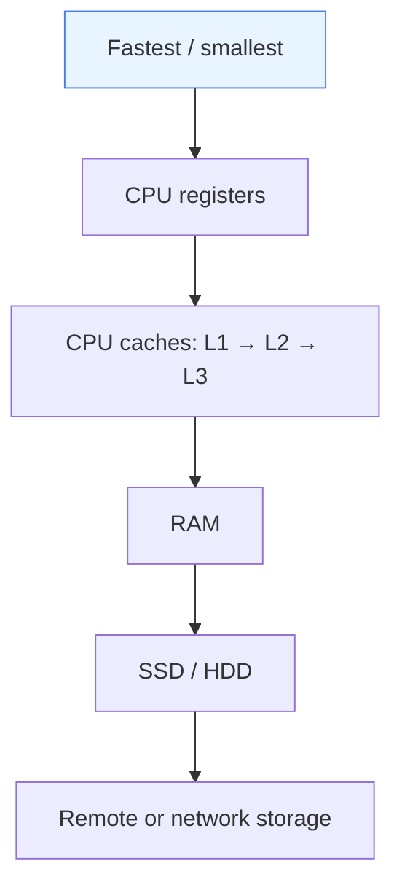
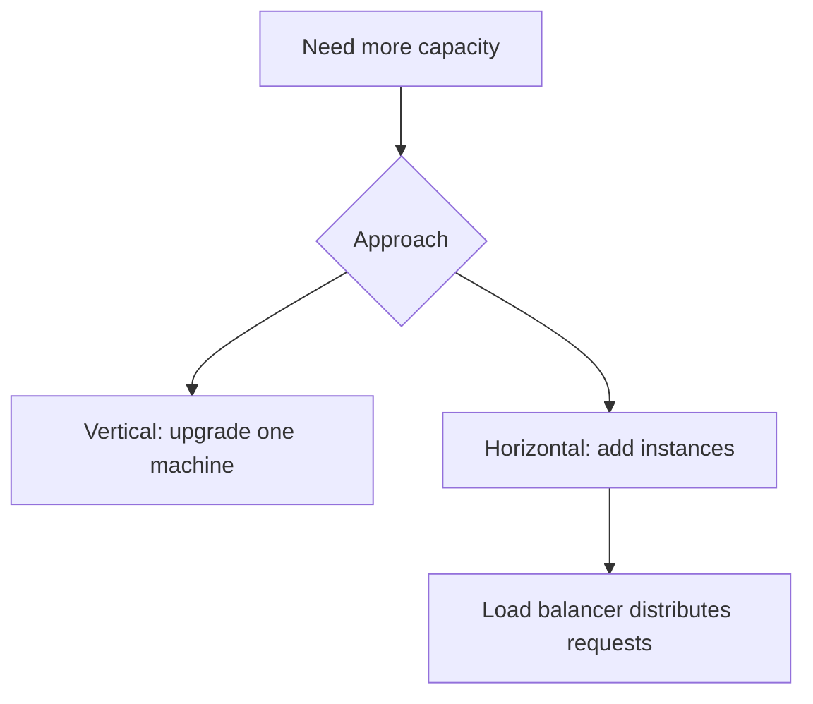

# 08 — Storage, Latency, Capacity and Scaling

## 1. Four performance terms

| Term | Meaning |
|---|---|
| Latency | Time taken for a request/operation to complete |
| Throughput | Amount of work completed per unit time |
| Bandwidth | Data-transfer capacity/rate |
| QPS | Queries or requests per second, depending on context |

Average request rate:

\[
\text{Average QPS} = \frac{\text{Requests per day}}{86{,}400}
\]

An average is not a peak-load estimate. Capacity planning should account for traffic spikes, request cost, read/write mix, payload sizes and dependency bottlenecks.

A request's latency may include network time, queueing, application work, database/storage access and response transfer.

## 2. Storage hierarchy

| Storage | Main property |
|---|---|
| Registers | Very fast CPU execution storage; extremely limited |
| L1/L2/L3 cache | Keeps frequently needed data close to CPU |
| RAM | Fast working memory; volatile |
| SSD/HDD | Persistent secondary storage; generally slower than RAM |
| Remote storage | Access also depends on network and service latency |

Exact cache sizes, sharing and access times depend on the hardware. Treat the hierarchy as a model, not a fixed performance table.

## 3. Sequential vs. random access

- **Sequential access:** data is read from nearby or ordered locations.
- **Random access:** operations jump between unrelated locations.

On HDDs, sequential access often avoids repeated mechanical seeks. SSDs have no moving read head, so their behavior differs, though access patterns and I/O sizes still matter.

## 4. Caching

A **cache** stores data in a faster location to reduce repeated work or access latency.

| Term | Meaning |
|---|---|
| Cache hit | Requested item is present |
| Cache miss | Item is absent and must be fetched/computed |
| TTL | Time after which an entry expires, if configured |
| Invalidation | Removing/refreshing stale data |

Examples include CPU caches, database buffers, Redis/application caches and DNS caches. Caching can reduce latency and load, but introduces memory cost and freshness/invalidation challenges.

## 5. Vertical vs. horizontal scaling

| Vertical scaling | Horizontal scaling |
|---|---|
| Add CPU/RAM or better resources to one machine | Add more machines/service instances |
| Operationally straightforward until hardware limits | Requires traffic distribution and handling shared state/failures |
| One machine remains a resource boundary | Can grow capacity across instances, if bottlenecks permit |

More instances do not automatically fix an inefficient query or a single overloaded database.

## Interview checks

**Latency vs. throughput?** Time per operation vs. work completed per unit time.

**Why do CPU caches exist?** To keep frequently used data/instructions closer to the CPU.

**What is a cache miss?** Requested data is not in cache and must be retrieved elsewhere.

**Why is RAM considered volatile?** Its contents are not generally retained after power loss.

**When can a cache cause a problem?** When cached values become stale, memory is wasted or invalidation is handled incorrectly.

**How would you investigate high latency?** Measure network, queueing, CPU/application, database/storage and response time before selecting an optimization.

## Remember

Identify the bottleneck first. Latency, throughput, storage access pattern and cache behavior help explain performance more reliably than assuming “add more servers.”
